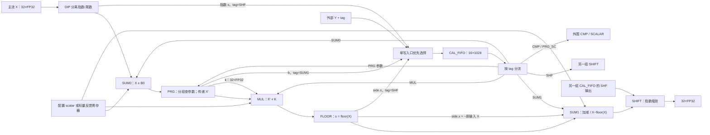
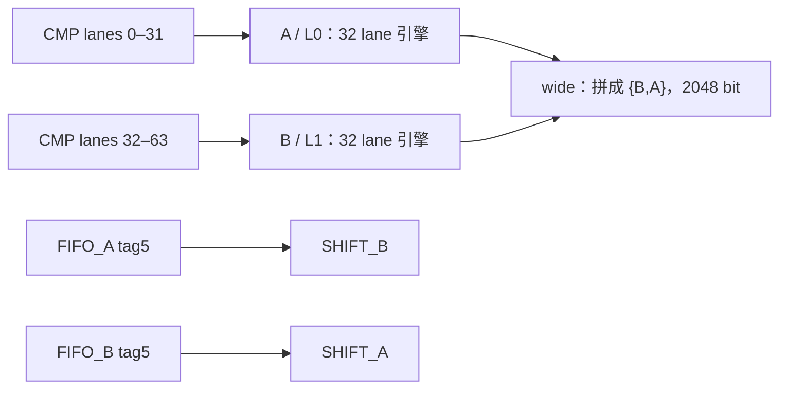
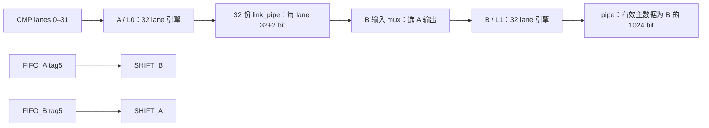
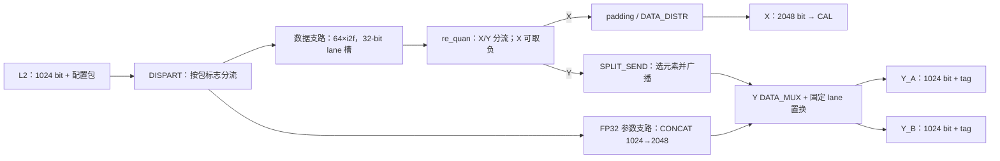

# 518 VP：双向量引擎与 PreCal/PostCal 的 RTL 连线证据

核对日期：2026-10-25。范围是本地 `design/rtl/zeus518/vp_v3/sub_module/` 的实际 Verilog 实例与赋值关系；该目录不是 Git checkout，因此以下用逐文件 SHA-256 固定快照。路径均相对此源码前缀，行号为该快照的一基行号。本文不附 RTL 源码，不包含仿真、综合、时序或硅上测量。方框表示功能模块，不表示一拍；握手、门控、可选 `*_IN_PIPE`/`*_OUT_PIPE` 宏会影响实际延迟。

本证据覆盖向量引擎内部与前后处理。MASK、CMP、SUM_TREE、SCALAR 内部另见相应证据，不能把这里省略的外围画成不存在。

## 单组引擎：32 个 FP32 lane 的固定顺序与有限旁路

`cal/vp_518_cal_group_para_engine.v` 的实例链是 `DIP → SUM0 → PRG → MUL → FLOOR → SUM1 → SHIFT`，主数据每边 1024 bit，valid/ready/end_chl/end_tile 为 32 路。证据：端口 64–100、常量 142–143，实例 483–727。每个模块有各自使能及 bypass，LUT 并不把它们变成任意排序的指令执行器。

建议主图画成下面结构；实线是主流，旁线明确写出数据含义：

`X` 在每个算术块表示该块当时的输入，不能把后段的 X 自动当成最初进入整条流水的原始向量。

| 模块 | 主路实际数据 | 第二操作数及旁路 | 精确证据 |
|---|---|---|---|
| DIP | 正常有限非零正规数域：从 FP32 位域得到带符号尾数或指数的 FP32 表示，`outdata_mux` 选择；不是通用 gather/split | side.s 是指数 FP32，按模式使能后写本组 FIFO，tag=SHF；NaN/Inf 等有专门分支 | `prl/vp_518_fp32_dispart.v:93–138`；engine `483–508`、`366–369` |
| SUM0 | 输入加/减 B | B 选本组 FIFO，或配置 scalar；scalar 档可由反馈寄存器替代。减法在 B 的符号侧处理 | `prl/vp_518_fp32_sumsub_group0.v:184–196`；engine `513–541` |
| PRG | 普通模式传当前 X；对称/旋转模式将符号清零后传当前 `abs(X)`；conv_mode 可处理 Inf | 参数通过 FIFO 加载；查得 k 直接送 MUL，b 写本组 FIFO（tag=SUM1）。旋转模式按原符号调整 k/b；PRG 本身不直接完成 kX+b | `prl/vp_518_param_gen_group.v:198–248`；`prl/vp_518_param_gen_self_sub.v:93–98,138–171`；engine `546–583` |
| MUL | 当前主流与 K 相乘 | K mux：0 scalar/反馈寄存器，1 FIFO，2 PRG.k，3 当前主流自身。因此 self 档可以平方，但不是任选前段旧 X。还有 judge/activation 配置，不能把所有模式简化成无条件乘法 | `prl/vp_518_fp32_mul_group.v:62–70,175–214`；engine `588–620` |
| FLOOR | main=s=floor(当前 X)，禁用则 bypass | side.s 也是 s，可写本组 FIFO；side.x 实际是符号翻转后的 `−X`，直接接本组 SUM1，不是原样的 X | `prl/vp_518_fp32_floor.v:347–397`；`prl/vp_518_fp32_floor_group.v:54–56,234–238`；engine `625–654` |
| SUM1 | 通常是当前主流 ± B；选 FLOOR 操作数时主流符号也翻转 | B mux：0 scalar/反馈寄存器，1 FIFO，2 FLOOR.side.x。FLOOR+SUB 配置令 `(-s)-(-X)=X-s`，构造小数部分；不能把该特殊路画成普通 `s−X` | `prl/vp_518_fp32_sumsub_group1.v:201–206,229–246`；engine `659–692` |
| SHIFT | 正常数域的指数缩放，语义近似 `X×2^(±s)`，含非正规数、饱和/溢出处理 | s 来自**另一组** FIFO 的 SHF 输出；先经 f2i（可配置到 INT8/FP32），使用结果低 8 bit 作为有符号 shift。不是 lane shuffle，不是任意整数按位移 | `prl/vp_518_fp32_shift_group.v:160–225`；`prl/vp_518_fp32_shift.v:108–113,254–270`；engine `699–727` |

PRG 参数分段数以实际端口为准：此 group 的 `i_seg_num` 只有 1 bit，self 保存 64 组参数并选择 32/64 档（`prl/vp_518_param_gen_self.v:174–176`）。不能依据陈旧注释把它写成支持 128 段。

## CAL_FIFO：容量、源冲突与目的路由

每组有一套，实例 `vp_518_fifo_16x1028`（`cal/prl/vp_518_cal_fifo.v:104–118`），一个 entry 为 1024-bit 向量 + 3-bit tag + 1-bit end_tile。该文件 58 行存在 `DW=1027` 常量，但实际端口/存储是 1028；图中应采用真实实例宽度。

入口不是四口并行写入，也不是会保存全部冲突请求的仲裁器：所有输入共享同一个可写 ready，`wr_en` 对四源 valid 取 OR，`wr_data` 固定优先级 **外部 Y > PRG.b > FLOOR.s > DIP.s**（83–97 行）。同拍多源有效时只能写入最高优先源；因此合法操作链必须满足源的互斥/时序条件。这里指出结构限制，不据此断言现有合法 kernel 已经丢数据。

入口源标签在 engine 350–369 行：外部 Y 携带原 tag；PRG.b 固定 tag4；FLOOR.s/DIP.s 固定 tag5。出口由 `vp_518_cal_fifo_demux` 按 tag 和模块 enable 分流，7 路为 CMP(0)、SUM0(1)、PRG(2)、MUL(3)、SUM1(4)、SHF(5)、PRG_SC(6)，见 engine 380–456。注意 FIFO 的 tag5 enable 来自对侧 SHIFT，随后经 1024-bit link_pipe 输出到对侧（460–479）。

因此 PRG.b 与外部 Y 的冲突首先发生在**每组自己的 CAL_FIFO 单写 mux**；外部 Y 如也是 SUM1 数据，后续还与 PRG.b 共用 tag4 出口。不存在独立的“PRG.b 专用缓存直达 SUM1”。DIP.s/FLOOR.s 也共用同一 FIFO，并非另有指数寄存器阵列。

标量反馈是另一条窄路：engine `731–766` 将反馈 32-bit 数据按 target 分发到 SUM0/MUL/SUM1 的标量寄存器；不是每个 lane 的通用寄存器文件。外围 CMP 的 FIFO_Y 路和标量 PRG 参数路由见下节。

## 两组实例如何组成 wide 与 pipe

`cal/vp_518_cal_group_top.v:674–871` 实例化两份同型 engine：A 为 `lane_00_31`，B 为 `lane_32_63`，各 32×32-bit。`i_cal_group_pipe_mode=0` 是 wide，1 是 pipe（42 行）。

| 项目 | A / L0 | B / L1 | 证据 |
|---|---|---|---|
| 模块使能 | 顶层 `i_cg_postcal_cfg_cal_group_unit_lut0[9:0]` | `i_cg_postcal_cfg_cal_group_unit_lut1[9:0]` | top `689,789`；engine `121–129,299–308` |
| SUM0/SUM1 模式与 B mux | L0 配置 | L1 的独立 mode/mux | top `690–695,790–795` |
| MUL K mux | L0 配置 | L1 的独立 K mux | top `698,798` |
| 共享配置 | SUM0/SUM1 scalar、MUL scalar/mode 等由共同端口连入 | 与 A 共用这些配置，不能声称两组所有控制完全独立 | top `690–713,790–813` |
| DIP 模式 | 顶层配置的 outdata_mode | 硬接 `S_ONLY` | top `703,803` |
| PRG 对称/旋转模式 | `fifo0_select` 接 `dip_mode` | `fifo1_select` 接 `dip_mode` | top `710,810` |
| Y | PreCal Y 低 1024 bit | PreCal Y 高 1024 bit | top `647–659,736–738,836–838` |
| FIFO → CMP | 接 CMP 低 32-lane 操作数 | 接 CMP 高 32-lane 操作数 | top `716–718,816–818` |
| FIFO → SCALAR PRG 参数 | A 的 `o_fio2scl_*` 接标量参数 | B 对应输出接 nc | top `720–722,820–822` |
| FIFO → SHIFT | A tag5 输出接 **B SHIFT** | B tag5 输出接 **A SHIFT** | top `724–732,824–832` |

顶层 LUT0 宽度是 11 bit，而向量 engine 接低 10 bit；不要把第 10 位也画进上述七段主流水。MASK/CMP/TREE/SCALAR 的使能范围须结合外围实例解释。

建议 wide/pipe 两张图复用相同 A/B 模块，切换的只有主路连接，交叉 SHIFT 旁路仍画出：

wide 主路 A 取 CMP 低半、B 取 CMP 高半（633–643、918–944）；pipe 将 A 输出经 32 份 `link_pipe(DATA_WIDTH=34,PIPE_DEPTH=1)` 接 B（884–944）。输出总线仍为 2048 bit：wide=`{B,A}`；pipe=`{1024'b0,B}`。但 pipe 的 **valid/end_chl/end_tile 是复制 B 两份**，而非高半 valid 置零（874–882）。教程可以说 pipe 只有 32 个有意义的结果，不能伪造 RTL 握手形状。

FLOOR 的三种内部模式由顶层重编码，并非 A/B 简单共用一个值（top `661–671`）：A 的 `S_AND_X` 在 pipe 下可开启第三路 s；B 是否需要 X 支路还受 L1 SUM1 的 FLOOR+SUB 配置影响。图中把 side 路画为“按配置使能”即可，不声称每条同时常开。

## PreCal：两个并行入口分支，不是一条串行的 concat/split

`pre_cal/vp_518_pre_cal.v:222–494` 证明的连接：

- **DISPART**：取配置包 `fp32_flag` 等标志，FP32 参数包走 `dis2con`，另一支走 `dis2fcv`；不是简单地“所有 FP32 主张量 bypass i2f”（`pre_cal_dispart.v:126–132,241–242`）。
- **i2f**：实际实例名 `vp_518_i2f`，不是另一个历史转换模块。64 份实例，8/16-bit 元素先放入 32-bit lane 槽；FP32 输入低 1024 bit + 高 1024 bit 零。FP32 输入或 pipe 模式仅低 32 lane 有效，否则 64 lane 有效（`pre_cal_fi2fp_group.v:90–137`）。这个层级不能据输入口 1024 bit 就宣称每拍计算 128 个 INT8。
- **re_quan**：本快照的 scale_a/zp_a/scale_b/zp_b 只归入 `nc_mix`；真正做的是按 flag 将数据送 X 或 Y，`i_requan_en` 时 X 做非零符号翻转，Y 原样传递。不能把这个模块名解释成已实现 `(x−zp)×scale` 的反量化乘加（`pre_cal_re_quan_group.v:65–98`）。
- **CONCAT**：非 bypass 时缓存连续两份 1024 bit，合成 2048 bit；第一次写低半，第二次写高半并产出 valid。bypass 是把一份 1024 bit **复制到两半**，不是 zero-extend（`pre_cal_concat.v:63–85,99–134`）。
- **SPLIT_SEND**：非 bypass 时缓存 Y 元素并按维度进度选出元素，广播到 32/64 lane；bypass 直接传完整 2048 bit。不要按名字画成“把 2048 拆成两个 1024 包”（`pre_cal_split_send.v:198–232,249–256`）。
- **DATA_MUX**：选择 CONCAT/Y_ONLY 参数支路或 SPLIT 支路；`line_ex_en` 是有限的固定置换（交换上下 32 lane、相邻 lane 交换、只对 SHF tag 交换上下半等），不等于任意 crossbar。最终输出两份 1024 bit + 3-bit tag（`pre_cal_data_mux.v:99–136,164–170`；`pre_cal.v:461–494`）。
- **DATA_DISTR**：padding 时将 32-bit padding 值广播到 64 lane；可为 Y_ONLY 操作产生结束 token（`pre_cal_data_distr.v:76–82,96–116`）。

## PostCal：真正的标量乘、加减、类型转换与打包

`post_cal/vp_518_post_cal_group_top.v:119–226` 的实际串接：

MUL 与 SUM/SUB 都由 `i_quan_en` 使能并具备 bypass。MUL 每 lane 共用一个 32-bit k（`fp32_mul_post_group.v:126–155`）；SUM/SUB 每 lane 共用 b，减法按配置翻转 b 符号（`fp32_sumsub_post_group.v:129–160`）。两者是**独立乘法器和加法器串联**，不能称作已证明单舍入 FMA。

实际转换叶子为 `vp_518_f2i`，由 `{1'b0,i_fmt_out}`、carry_sel、conv_mode 控制，转换结果暂放在每 lane 的 32-bit 槽（`fp2fi_post_group.v:101–124`）；尽管名字带 i，它处理所选输出格式，不能只写成“转整数”。

`P2S` 实际实例在 `p2s_post_group.v:215`，输入 2048 bit，输出 1024 bit。`p2s.v:139–152,190–236` 展示格式相关重排：

| 路径 | 常规完整组的打包方式 |
|---|---|
| 32 个 FP32 结果 → FP32 | 取低 32 lane，一份 1024-bit 输出 |
| 32 个 FP32 结果 → BF16/8-bit | 逐 lane 取已转换结果的低 16/8 bit，得到 512/256-bit 有效 payload，其余填零 |
| wide 的 64 个窄输入元素 → FP32 结果 | 在非 tree_acc 情形，64×32-bit 拆成两份 1024-bit 输出；尾组受 dst_c_size 约束 |
| wide 的 64 个结果 → BF16/8-bit | 逐 lane 取低 16/8 bit，形成 1024/512-bit payload |
| pipe | P2S 将其视为 32-lane 输入形状，不因原始输入是 BF16 就把零高半当第二组有效结果 |

以上是数据整形关系，不承诺每周期发包。split 路径会在两拍之间保持输入，tail/strobe 依 dst_c_size/tree 配置计算（`p2s.v:252–337`）。顶层 `post_working_flag` 还会在接受输入 end_tile 后等待输出 end_tile 被接收再解除阻挡（`post_cal_group_top.v:229–240`）。

## 文件指纹

下表路径相对 `rtl/zeus518/vp_v3/sub_module/`，SHA-256 对应本次只读检查的完整文件。它们固定本证据范围，不代表所有 518 RTL 版本。

| 文件 | SHA-256 |
|---|---|
| `cal/vp_518_cal_group_top.v` | `2b00edceb4b2be634022cae5ef951f5309cae2e4b61fa6891303c0d651a9e823` |
| `cal/vp_518_cal_group_para_engine.v` | `875dec6d9b6a082a87c0416a007cde52325d58f984fbe0aad3c3985b64a8333a` |
| `cal/prl/vp_518_cal_fifo.v` | `5254f254deda2309c2c8d08818af76e25e83f23e6223719470ac5d43f474bea0` |
| `cal/prl/vp_518_fp32_dispart.v` | `c821fa8667f64dcb7b028eb0c252113e6dd48f2152d35062795fa1649e8fd2ec` |
| `cal/prl/vp_518_fp32_dispart_group.v` | `803f6f3c08fbd855bb944e4d8273e2228f79b7c2db3a457ad9b5fc4a7f4f585b` |
| `cal/prl/vp_518_fp32_sumsub_group0.v` | `d2cdd0b78a178cc0481db21e058b4d91c44eab6b1a327d9edb78f79fcea393ed` |
| `cal/prl/vp_518_param_gen_group.v` | `a3e81c8e05aa4acc394b0d9673053747d78373f1d64d3166e572bd1c2a8ba580` |
| `cal/prl/vp_518_param_gen_self.v` | `149cccadc78e208cb92ad01e88749252b6d8137adf5f9023943c9070f8a0f25d` |
| `cal/prl/vp_518_param_gen_self_sub.v` | `941083577c29d01960f0dd654dd5e83e5e23d75a896898c3fc344f30f00f6bb4` |
| `cal/prl/vp_518_fp32_mul_group.v` | `e0d9fdd603db9dd63d0e720041f5867a56a14fae36aa72b04fafa374adeb9a18` |
| `cal/prl/vp_518_fp32_floor.v` | `391ffd488966f0b243f15a91b1a6725ee6421c989c03ab0321600bb6bafe425b` |
| `cal/prl/vp_518_fp32_floor_group.v` | `025730931ef3b76618d4d6ffe0d96d7d039a3ca5d3a4d422c06f264dce5d19f5` |
| `cal/prl/vp_518_fp32_sumsub_group1.v` | `9e50ae8be9ca918b29f08887e58bde7b3632909cc7fa6b209092601f2e7b5ebf` |
| `cal/prl/vp_518_fp32_shift_group.v` | `6013da6d62dc77f1abe75378a2c25430e48b8a5c5a6048b4bfb90d60434b53fa` |
| `cal/prl/vp_518_fp32_shift.v` | `c8095231931f8864de38da7d391331a2552236a761aee54e0c545f1559cf2bc7` |
| `pre_cal/vp_518_pre_cal.v` | `88b3fb6cb77473288ec6ed56b0d9aaee3f02f97e8f002f0ca2c07839e3466ec5` |
| `pre_cal/vp_518_pre_cal_dispart.v` | `56c1f13a7acb4c4bcf082643fc8e6939af3c2058ca267bfd80ed15edb32b363d` |
| `pre_cal/vp_518_pre_cal_fi2fp_group.v` | `79c7bfe2690a5b4545031d2e9bed5cb56bfa3c9b520f7d9c317488a33279d198` |
| `pre_cal/vp_518_pre_cal_re_quan_group.v` | `f23b5cef94f8cf8d85aa3dd9e2cb1a1c0095fe5c611c22a8a7b84cfd01909766` |
| `pre_cal/vp_518_pre_cal_concat.v` | `5650720ddc57aa2e17436594458a561192c93551d24739d13b81d9d82a7b9204` |
| `pre_cal/vp_518_pre_cal_split_send.v` | `0410b8e4da0d51ffb706d287b56ce5f87940c2dea5b4ce293c1fb6cac4e9a14c` |
| `pre_cal/vp_518_pre_cal_data_mux.v` | `969538f42b063fa140e89e4842411e0e887759b67145c2c65570e51dd512f915` |
| `pre_cal/vp_518_pre_cal_data_distr.v` | `e3aaabd955cf832fd84dccb3a7be920868785078b85d26b2a71322d5115a1956` |
| `post_cal/vp_518_post_cal_group_top.v` | `23d0c309ba3654f94d4754b4734760888811e5fa04aed708d80bc08f3f3d7530` |
| `post_cal/vp_518_fp32_mul_post_group.v` | `af873f21090b376a37da86afe5a4fa22600480071db2905356fa1e97103fb79a` |
| `post_cal/vp_518_fp32_sumsub_post_group.v` | `0c1f4a5665d1ba478151a72f6bf96fe3bdf2808cc82d7e0e132ceb6460a2129d` |
| `post_cal/vp_518_fp2fi_post_group.v` | `8b0fd0d6ec19cddc3a88fe4423648370ff42e82404a797a809d14371895a92bc` |
| `post_cal/vp_518_p2s_post_group.v` | `575bf9d80e14643c4746d52fd25884cc8fe8f01d09ab90f7ebdad4541524313f` |
| `post_cal/vp_518_p2s.v` | `513ce1f12284eb44f83b5f2861ecf6a17a5b3b0a410565b4a121488cd97e91d7` |
